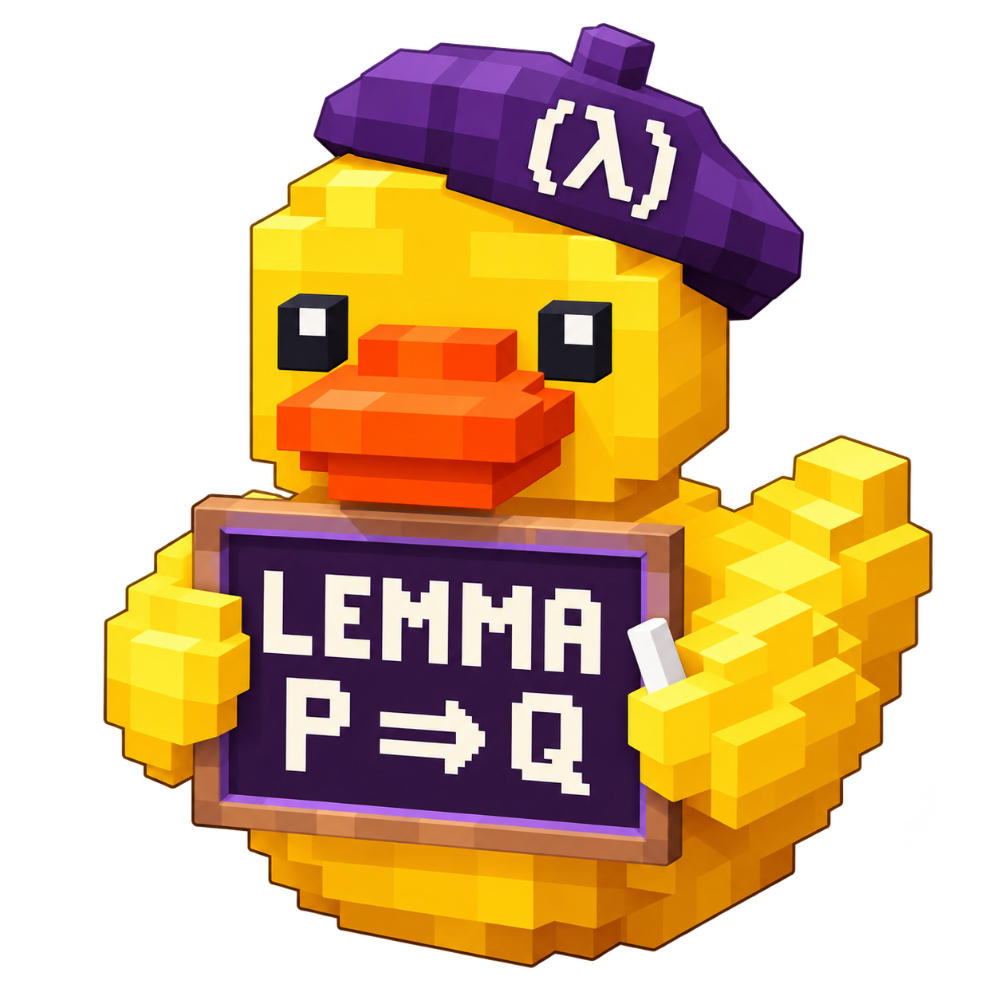

<h1 align="center">LemmaDuck</h1>
<p align="center"><strong>Talk to the duck. Test your hunch.</strong></p>

LemmaDuck is your lab copilot, available in three distros from this one repository. Choose the workspace you
want; the shared engine handles models, account sign-in, research tasks and project
connections. Code development uses **OMP**. Research, writing, review and assistant
work use the managed **Pi** worker.

<table>
  <tr>
    <td align="center" width="33%"><a href="https://github.com/ts06068/lemmaduck#getting-started-with-paseo"></a></td>
    <td align="center" width="33%"><a href="https://github.com/ts06068/lemmaduck/tree/main/distros/emacs"></a></td>
    <td align="center" width="33%"><a href="https://github.com/ts06068/lemmaduck/tree/main/distros/neovim"></a></td>
  </tr>
  <tr>
    <th><a href="https://github.com/ts06068/lemmaduck">Base</a></th>
    <th><a href="https://github.com/ts06068/lemmaduck/tree/main/distros/emacs">Emacs</a></th>
    <th><a href="https://github.com/ts06068/lemmaduck/tree/main/distros/neovim">Neovim</a></th>
  </tr>
  <tr>
    <td align="center">Paseo desktop / tablet<br>Shared engine · v0.5.2</td>
    <td align="center">Emacs research workspace<br>Terminal integration · preview</td>
    <td align="center">Neovim editor workspace<br>Terminal integration · preview</td>
  </tr>
  <tr>
    <td align="center"><a href="#getting-started-with-paseo">Get started</a> · <a href="https://github.com/ts06068/lemmaduck/releases">Releases</a></td>
    <td align="center"><a href="https://github.com/ts06068/lemmaduck/tree/main/distros/emacs#getting-started">Get started</a> · <a href="https://github.com/ts06068/lemmaduck/releases?q=emacs-v">Releases</a></td>
    <td align="center"><a href="https://github.com/ts06068/lemmaduck/tree/main/distros/neovim#getting-started">Get started</a> · <a href="https://github.com/ts06068/lemmaduck/releases?q=neovim-v">Releases</a></td>
  </tr>
</table>

**Start with Base** if you want Paseo on desktop and tablet. VS Code can stay open
for project navigation and editing. The editor distros connect to the same installed
engine on the same host and account; they do not need another model subscription.
Their first preview launches the workers in editor terminals. Native ACP/RPC chat
buffers and attachment to an already-running Paseo conversation are separate work.

Install with npm or clone once: Base and the shared engine live at the repository root; the editor
workspaces live in `distros/emacs` and `distros/neovim`. All three release channels
and package workflows are maintained in this repository.

Release names, tags, download filenames and manifests identify the distro.
See [npm installation and updates](docs/INSTALL.md) and [the distro reference](docs/DISTROS.md).

## Getting started with Paseo

This walkthrough sets up the host once and opens a reproducible manuscript check. The project uses three synthetic observations and can be checked without a model account.

### 1. Choose the computer that will run the agents

Use **x86-64 Linux**, Git and Python 3.12 or later. Ubuntu 24.04 is a suitable host. On the host run `uname -sm` and look for `Linux x86_64`. On Ubuntu you can install the prerequisites with `sudo apt install git python3`.

| Where you sit | Where to open the first shell |
| --- | --- |
| Linux x64 desktop | Open a local terminal. Paseo Desktop can manage the local daemon. |
| Windows x64 with WSL2 | Open the Ubuntu x64 shell. Run the host setup and Paseo daemon inside that distribution. |
| Surface Pro 11 (Windows ARM64) or macOS | SSH into your Linux x64 host. Install Paseo Desktop on the device with your screen. |
| Galaxy Tab S11 Ultra | Set up the Linux host from an SSH client or another computer. Use the Paseo Android app to connect in step 2. |

[Download Paseo for desktop or Android](https://paseo.sh/download) · [WSL installation](https://learn.microsoft.com/windows/wsl/install)

### 2. Install once and connect the client

In the **Linux host shell**, install the Base npm package. Use Node.js 22.19+,
npm, Git and Python 3.12+. GitHub Packages requires a one-time registry login:
use your GitHub username and a classic token with `read:packages` at the password
prompt. [Installation, updates and the login-free release-URL option](docs/INSTALL.md).

```sh
npm config set @ts06068:registry https://npm.pkg.github.com --location=user
npm login --scope=@ts06068 --auth-type=legacy --registry=https://npm.pkg.github.com
npm install --global --prefix "$HOME/.local" @ts06068/lemmaduck-base@latest
export PATH="$HOME/.local/bin:$PATH"
lemmaduck setup --full
lemmaduck doctor
```

For an editor workspace, keep Base installed and add
`@ts06068/lemmaduck-emacs@preview` or `@ts06068/lemmaduck-neovim@preview` using the
same `npm install --global --prefix "$HOME/.local"` command. Their executable
names are `lemmaduck-emacs` and `lemmaduck-neovim`.

To update, rerun the npm install command for the packages/channels you use, then
run `lemmaduck setup --full` and reopen the workers. State and credentials remain
in their existing user directories. Developers can still clone this repository
and run `./lemmaduck setup --full` from the checkout.

Full setup installs Paseo **0.14.0**, OMP **18.14.2**, Jujutsu **0.46.0**, the Pi worker and Google runtime. It verifies **1,137 pstack paths** and **4,528 gstack paths** and adds a **LemmaDuck Code** provider to the host's Paseo configuration. For a source install, keep the checkout at its installed path. Use `lemmaduck setup --full --dry-run` to preview. In a new terminal, repeat the `export PATH` line if needed.

- **Local Paseo Desktop** — Open the local host. If it was running during setup, run `lemmaduck paseo reload` in the host shell.
- **Headless Linux or WSL2** — Run `lemmaduck paseo` in the host shell and follow its connection prompt. On desktop choose **Settings → Add host → Remote SSH** for an SSH-reachable server. On Android use **Pair Device** and the QR from the host, or add a direct address on your private network. Use a connection approved for the host and its data. [Paseo connectivity](https://paseo.sh/docs/connectivity)

In Paseo, open a workspace on that host and open its **Terminal**. Use this terminal for the research walkthrough below. For a software project, skip to [Code development with OMP](#code-development-with-omp).

### 3. Prepare your first project

```sh
lemmaduck init "$HOME/projects/duck-first-study" --kind demo
cd "$HOME/projects/duck-first-study"
python3 reproduce.py
python3 reproduce.py --check
```

The draft reports **25 units**. The observations are **10, 20 and 30**, so their mean is **20 units**. You should see `C01: discrepancy; n=3, mean=20`. Open `results/claim.md` for the source rows and `results/manifest.json` for the file hashes. To repeat the exercise in the same folder, rerun `reproduce.py`.

### 4. Sign in to one worker and ask it to check the claim

In the **ordinary Linux shell**, sign in to the subscription you want to use. For ChatGPT:

```sh
lemmaduck login chatgpt
```

When Pi opens, enter `/login openai-codex`, follow the sign-in instructions, then enter `/quit` to return to the shell. After checking that paid extras and auto-refill are disabled on your account, record that setting and start the agent:

```sh
lemmaduck billing confirm chatgpt --extra-usage-off
lemmaduck agent "$HOME/projects/duck-first-study"
```

**You are now in the agent prompt.** Enter these lines **one at a time**. The last one opens a model picker. Select an available model and press Enter.

```text
/task new Check the mean reported in the manuscript
/task add observations.csv
/task add draft.md
/switch chatgpt
```

Then give the worker its first request:

> Read observations.csv and draft.md. Recompute the mean, show the arithmetic, and identify the sentence that needs a correction. Leave the original draft intact.

Use `/task` to inspect the saved task and `/usage` to see reported usage. For a personal Claude plan, use `lemmaduck login claude`, confirm the account setting with `lemmaduck billing confirm claude --extra-usage-off`, then enter `/switch claude`. The published Claude Code executable handles sign-in. For Gemini, use the corresponding `gemini` commands. [Provider and billing details](docs/PROVIDERS.md) A worker hitting its quota pauses the task. You choose whether to switch.

### 5. Save, review and return

Enter `/handoff` in the agent prompt to save a short packet. To review the work, enter `/review` and select a worker for a separate read-only review. Return to the same terminal from either Paseo client. If the worker exited, open a terminal on the **same host, account and project path** and run:

```sh
export PATH="$HOME/.local/bin:$PATH"
lemmaduck status "$HOME/projects/duck-first-study"
lemmaduck agent "$HOME/projects/duck-first-study"
```

Use `/task` to inspect the existing goal, then `/switch chatgpt` to start the next segment. `/task new` starts a different task. If an interrupted operation shows `unknown`, inspect its effect before marking it completed or failed. [Task and recovery reference](docs/OPERATIONS.md)

## Code development with OMP

Create a coding project in the host terminal. A development template contains a `.lemmaduck-kind` file, so the usual `agent` command starts OMP automatically.

```sh
lemmaduck init "$HOME/projects/duck-code" --kind development
lemmaduck agent "$HOME/projects/duck-code"
```

For an existing checkout, use `lemmaduck code /path/to/repo`. To use Paseo's chat, open that same folder as a workspace, choose **New Agent → LemmaDuck Code** and select your configured model. The terminal command and the Paseo provider use the same OMP profile. Register an account or a local model on the host first. For ChatGPT, open the terminal command, enter `/login openai-codex` and sign in to your own account, then select a model with `/model`. A registered loopback model can run without a cloud account. [Model configuration and Claude billing](docs/PROVIDERS.md)

Try “Reproduce the failing test, fix the underlying function and rerun that test.” Review the diff in Paseo or VS Code. For a manuscript or a read-only research review in that same checkout, run `lemmaduck agent /path/to/repo --pi` in a terminal. OMP keeps its coding sessions separately from Pi's task journal. In OMP, `/review` reviews code changes. In Pi, `/review` starts a separate read-only research segment.

## Let the task choose the worker

After signing in and confirming account billing settings, use `/ask` in the Pi prompt. The harness selects a ready provider, model and requested reasoning level for a fresh task segment. Normal follow-ups stay with that worker.

| Task | Default | Reasoning preference |
| --- | --- | --- |
| Schedules, email and routine assistance | Gemini in Pi | low |
| Manuscript sentences, translation and editing | Gemini in Pi | medium |
| Research design, proof and demanding analysis | ChatGPT, then Claude, in Pi | high |
| Abduction and competing explanations | ChatGPT, then Claude, in Pi | high |
| Code implementation and debugging | ChatGPT in OMP | medium |

```text
/ask Draft a Korean reply using the selected email and my approved examples.
/ask Edit the selected manuscript paragraph without changing its claims or citations.
/ask Generate competing hypotheses for this observation and propose a discriminating experiment.
```

Use `/route writing` or `/route abduction` to set the profile explicitly and `/route auto` to restore classification. `/switch` still opens a manual model picker. The router uses visible task cues and account readiness; it does not claim to find the optimal model. Gemini's current ACP connection manages its actual model and reasoning internally. LemmaDuck records that limitation instead of claiming the preferred level was applied. Other models use the levels their runtime supports.

To customize provider order, exact model IDs and reasoning levels, run `lemmaduck routing init` in the **host shell**, then edit the path it prints. `lemmaduck routing show` displays the effective policy. Explicit OMP `--model`/`--thinking` options and Paseo's model choice override coding launch defaults. [Routing and limitations](docs/ROUTING.md)

Writing routes preserve the author's intent, facts and approved voice samples, separate factual issues from stylistic edits, and keep drafts reviewable. Coding starts by inspecting existing behavior, standard-library facilities and installed dependencies. [Writing and desloping](docs/WRITING.md)

## Git, Jujutsu and project management

Keep using VS Code to navigate and edit the checkout. LemmaDuck detects Git or Jujutsu, records version-control state in Pi task checkpoints, and exposes status/diff/log inspection to the worker. OMP uses the host's normal Git/jj workflow for development. Jujutsu inspection reads recorded state without automatically snapshotting working-copy changes. [VCS guide](docs/VCS.md)

```sh
lemmaduck vcs /path/to/repo status
lemmaduck connector add work.github github
lemmaduck connector add work.linear linear
lemmaduck connector add work.jira jira
```

The connector commands create local presets. Supply account credentials, discover the server's tools, and allow the operations you intend to use. Pi and Gemini share those allowed tools; OMP can call the same connector CLI. Read-only reviews reject external modifications. Other remote effects display the account and full payload for confirmation and receive a replay-protected receipt. [Connect GitHub, Linear and Jira](docs/CONNECTORS.md)

Use `/task link ISSUE_URL` in Pi to preserve a GitHub, Linear or Jira reference across handoffs. A link records context; it does not create an automatic two-way status sync.

## Workflows and project types

| For this work | Start here |
| --- | --- |
| Investigate a research question | `lemmaduck init PATH --kind research` creates a protocol and claim ledger. Attach `/workflow pstack:sharpen` in the agent prompt, switch workers, and ask for competing explanations and a discriminating experiment. |
| Build or review software | `--kind development` creates an OMP project with an implementation plan. Look up `pstack:tdd`, `gstack:plan-eng-review` or `gstack:qa`. |
| Draft in Korean or English | `--kind writing` creates a brief for audience, approved examples, facts and uncertainty. Attach `pstack:technical-writing` or `pstack:unslop`. |
| Triage messages or follow up on work | `--kind assistant` creates an inbox and action record. Configure each work or personal account separately through the [connector guide](docs/CONNECTORS.md). |
| Work on an existing project | Use `lemmaduck code PATH` for code or `lemmaduck agent PATH --pi` for research, writing or assistant work. Unmarked projects default to Pi. |

In a regular shell, run `lemmaduck workflow list pstack` to see available names or `lemmaduck workflow show gstack:qa` to read a pinned entry. In the Pi prompt, `/workflow NAME` attaches that entry to the task and its handoff. The worker can read the full text in chunks. Interactive commands attach one workflow at a time. Cursor-hosted automations, browser QA and deployments require their own host, tools and permissions. [Full workflow inventory](catalog/workflow-routing.tsv)

## Development

```sh
npm ci --include=dev --ignore-scripts --no-audit --no-fund
npm run check
npm run build
npm test
python3 -m unittest discover -s tests -p 'test_*.py'
```

Accounts, live tasks, retrieved records and connector credentials belong on the execution host. See the [full design (Korean)](docs/DESIGN.ko.md), [capability catalog](catalog/full.json), [provider configuration](docs/PROVIDERS.md), and [local storage and recovery guide](docs/OPERATIONS.md).
