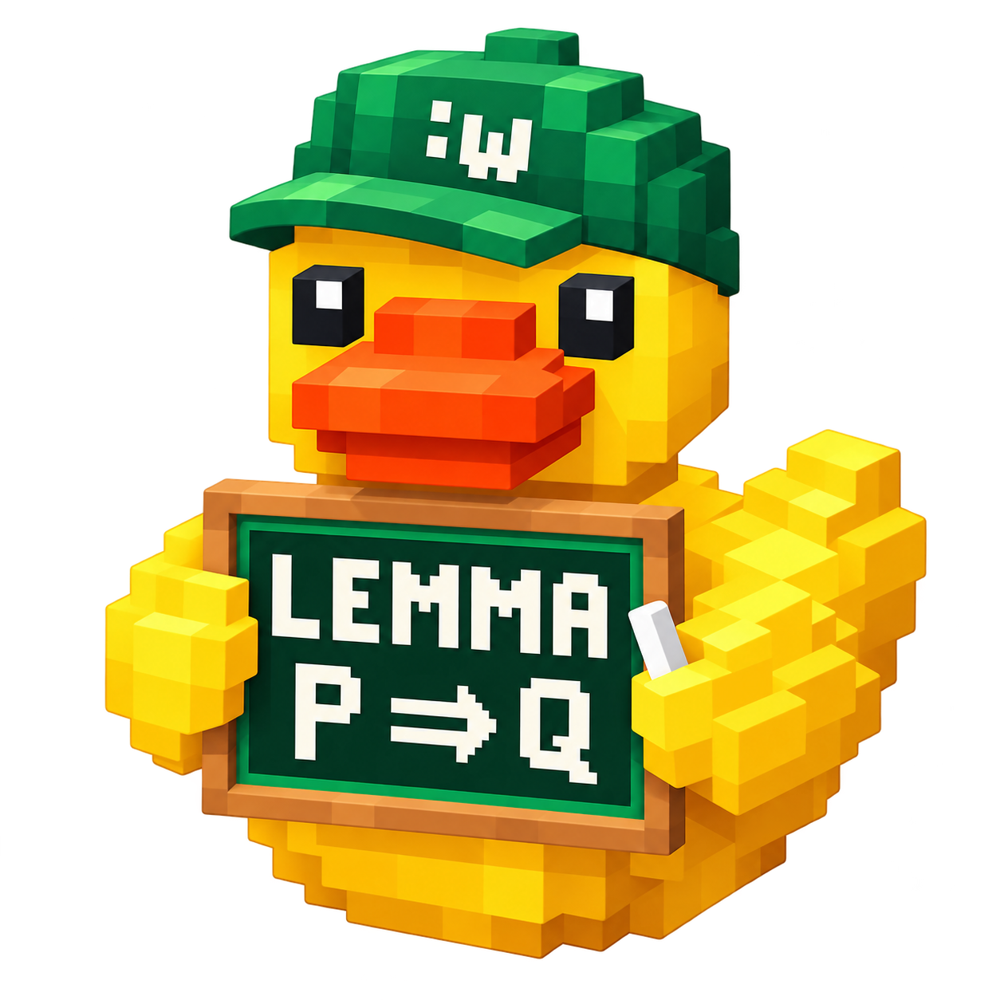

<p align="center"></p>
<h1 align="center">LemmaDuck Neovim</h1>
<p align="center"><strong>Talk to the duck. Test your hunch.</strong></p>

**Distro: `neovim` · Version: `0.1.0-alpha.3` · Preview**

An isolated Neovim workspace for the shared [LemmaDuck engine](https://github.com/ts06068/lemmaduck).
Code development uses OMP. Research, writing and assistant work use the managed Pi worker.
Model routing, account sign-in, connector permissions and task records stay in the engine.

[Base](https://github.com/ts06068/lemmaduck) · [Emacs](https://github.com/ts06068/lemmaduck/tree/main/distros/emacs) · [Neovim](https://github.com/ts06068/lemmaduck/tree/main/distros/neovim) · [Releases](https://github.com/ts06068/lemmaduck/releases?q=neovim-v)

## Getting started

Use the same **Linux x86-64 host and user account** as LemmaDuck, with Python 3.12+ and Neovim 0.9.5+ for the minimal profile; Neovim 0.11+ for the optional LazyVim profile. On a remote host, run this editor in an SSH terminal; a local desktop-to-remote native editor connection is not part of this preview.

### Install with npm

Follow the [one-time registry login and Base installation](../../docs/INSTALL.md),
then add this editor distro:

```sh
npm install --global --prefix "$HOME/.local" @ts06068/lemmaduck-neovim@preview
export PATH="$HOME/.local/bin:$PATH"
lemmaduck-neovim --doctor
lemmaduck-neovim /path/to/project
```

Repeat the install command to update to the current `preview`; update Base with
`@ts06068/lemmaduck-base@latest`. Editor state and engine task locations remain
unchanged. The OS editor binary is a separate prerequisite.

### Install from source

1. Clone the monorepo once and follow the [base installation and account setup](../../docs/GETTING_STARTED.md#getting-started-with-paseo). If you already have the checkout, update it and reuse it. The editor and engine are tested together at the same commit; no second repository is required.
2. From the repository root, enter this distro and check the local programs:

```sh
git clone https://github.com/ts06068/lemmaduck.git
cd lemmaduck
./lemmaduck setup --full
export PATH="$HOME/.local/bin:$PATH"
cd distros/neovim
./bin/lemmaduck-neovim --doctor
```

3. Prepare the shared synthetic example, or use an existing project:

```sh
lemmaduck init "$HOME/projects/duck-first-study" --kind demo
./bin/lemmaduck-neovim "$HOME/projects/duck-first-study"
```

If that directory already exists, skip `init`. In the research worker, use `/ask Check observations.csv against draft.md and explain the mean discrepancy.` The observations have mean **20**, while the draft says **25**. `/task`, `/review` and `/handoff` are engine commands entered inside the worker.

## Use the workspace

Run `:LemmaDuckResearch`, `:LemmaDuckCode`, `:LemmaDuckResume`, or `:LemmaDuckStatus`. The start screen also lists single-key actions. In a terminal buffer, press `Ctrl-\` then `Ctrl-N` to return to editing. Select text and run `:LemmaDuckContext` to copy context with source lines.

The default profile has no plugin downloads. For the pinned LazyVim profile inherited from the main project:

```sh
./bin/lemmaduck-neovim --profile lazyvim "$HOME/projects/duck-first-study"
```

That profile downloads plugins on first use and requires Git, a compiler and the dependencies listed by LazyVim. Its plugin revisions are in `profiles/lazyvim/lazy-lock.json`. Run `:Lazy restore` after installation to apply the lock. The distro commands are available in either profile.

The launcher uses `NVIM_APPNAME=lemmaduck-neovim` and its own startup file.
It does not replace your normal editor configuration. Set `LEMMADUCK_EXECUTABLE` to a single executable path if the engine is not in `PATH`; set `LEMMADUCK_EDITOR` to select the editor executable.

## What this preview supports

- Open a project, launch Pi or OMP in an editor terminal, and inspect shared task status.
- Reuse a running terminal within this editor; copy selected source context before submitting it.
- Continue saved engine work on the same host/account/project, subject to the engine's process lock and reconciliation rules.

Native ACP/RPC chat buffers, cross-client attachment to a live conversation, and direct remote-editor transport are **not implemented in this release**. A terminal launch does not imply those integrations are compatible. Account login and live model calls remain separate validation steps. The editor does not add its own credentials or API billing route.

## Releases and packages

All releases are published in the main `ts06068/lemmaduck` repository. Tags are **`neovim-vVERSION`**. Release titles are also **`neovim-vVERSION`**.
Download assets begin with **`lemmaduck-neovim-VERSION`**, and each archive contains a `release-manifest.json` with distro, version, engine reference and source commit. Verify downloads against the attached SHA-256 file.

An editor-only release archive can also be extracted and launched with `./bin/lemmaduck-neovim`; install the shared engine separately using the main repository. Development and release commands below assume the full monorepo checkout.

The npm package is **`@ts06068/lemmaduck-neovim`**, hosted on GitHub Packages with the **`preview`** update channel. Release publication automatically publishes the package. See [installation and updates](../../docs/INSTALL.md) for registry login, exact versions and public release-URL installs. This is an npm distribution of the launcher and editor files; it is not a MELPA or LuaRocks registration.

## Development

```sh
python3 -m unittest discover -s tests -p 'test_*.py'
nvim --headless -u ./init.lua -c "luafile tests/editor.lua"
python3 ../../scripts/build_release.py --distro neovim --tag neovim-v0.1.0-alpha.3 --npm
```

Release packaging uses Git-tracked files. Stage new files before a local packaging check. The release workflow builds from the tagged commit after running the editor checks. See [validation](VALIDATION.md).
